# Application Compatibility

## Current status

MrpEmu can execute MRP applications. The headless video test drives startup
and key input at 30 guest frames per second. The video check requires
non-uniform RGB565 pixels across at least one eighth of the display rows
and at least 0.5% of its pixels. Thin strips and uniform frames are reported
separately. Playability requires a reproducible gameplay sequence.

## How applications are verified

Compatibility rows are only added after reproducible runs:

- A run loads a legally obtained `.mrp` package in the standalone frontend or
  the RetroArch core and follows a described input sequence.
- A row records what was actually observed (screens reached, input that
  worked), not intentions. A loading screen or a correct-looking window alone
  does not establish compatibility.
- "Playable" requires entering and operating core gameplay in a scripted run;
  complete playthroughs and audio are tracked separately in the notes.

Reproducible captures use the standalone frontend's headless mode and
`scripts/batch-screenshots.ps1`. Record the exact `--screenshot-frames` and
`--press` sequence in the note column so another machine can repeat the run.

Status levels used in the table:

| Status | Meaning |
| --- | --- |
| Playable | Core gameplay entered and operated in scripted runs (not necessarily completed) |
| Partial | Interactive screens verified; gameplay unverified or only partly verified |
| Boots only | Renders startup screens; interaction not verified |
| Blocked (network) | The tested entry path requires a network service unavailable in the emulator |
| Fails to start | Guest execution stops during startup |

## Hot-game corpus

The local test corpus is `tmp/mrp_game/热门游戏` with 105 `.mrp` packages; packages are not committed. Each package was captured twice with the standalone frontend: 200 frames idle, and 200 frames with left-soft-key presses at frames 30, 60, 90, 120, 150 and 180. The richer screen is shown below. Six packages use the idle capture because the scripted run either faulted or produced a less informative screen; their notes say so.

Reproduce the table images (all 105 files, ~50 seconds) with:

```powershell
./scripts/batch-screenshots.ps1 -GameDirectory tmp/mrp_game/热门游戏 `
  -OutputDirectory docs/images/hot -Frames 200 `
  -Press 30:lsk,60:lsk,90:lsk,120:lsk,150:lsk,180:lsk
```

The capture records `frame nonzero=N colors=C`; a blank frame is not saved. Screenshots prove that a screen rendered and what it showed. A title, menu, tutorial or gameplay frame is not a full playthrough, and in-game controls and audio remain unverified. No package in this corpus is rated Playable yet.

Across 105 captures: 31 Partial, 59 Boots only, 15 Blocked (network), 0 Fails to start.

### Application list

| # | Application / file | Screen | Screenshot | Status | Capture | Notes |
| ---: | --- | --- | --- | --- | --- | --- |
| 1 | `007烈焰行动.mrp` | 240×320 | 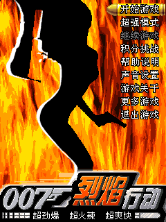 | Partial | 200f + 6×lsk | Flame title art with 007烈焰行动 branding and a menu list. |
| 2 | `311061魔神傲世录.mrp` | 240×320 | 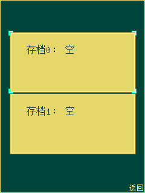 | Partial | 200f + 6×lsk | Save-slot menu with two empty 存档1 slots; no gameplay entered. |
| 3 | `399356三国战纪灭神录（资）.mrp` | 240×320 | 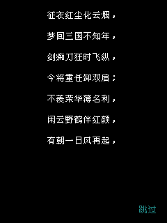 | Boots only | 200f + 6×lsk | Black story page with Chinese verse text and a 返回 softkey. |
| 4 | `[破解]水果争霸.mrp` | 240×320 | 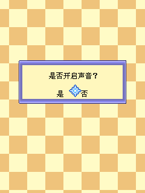 | Boots only | 200f + 6×lsk | 是否开启声音? audio prompt over a checkerboard background; scripted presses do not advance it. |
| 5 | `cs反恐-沙漠之狐破解版.mrp` | 240×320 |  | Blocked (network) | 200f + 6×lsk | 连接服务器失败 (server connection failed) with a 返回 softkey. |
| 6 | `Super赛亚人传说.mrp` | 240×320 |  | Boots only | 200f + 6×lsk | Dark screen with faint title text; no menu or gameplay reached. |
| 7 | `Super赛亚人传说（已破解）(1).mrp` | 240×320 |  | Boots only | 200f idle | Idle capture shown: 声音设置 with 是否开启声音? / 开启 / 关闭. The scripted run did not render a frame. |
| 8 | `Super赛亚人传说（已破解）.mrp` | 240×320 |  | Boots only | 200f idle | Idle capture shown: 声音设置 with 是否开启声音? / 开启 / 关闭. The scripted run did not render a frame. |
| 9 | `【古惑仔】.mrp` | 240×320 | 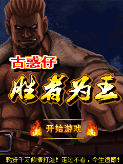 | Partial | 200f + 6×lsk | 古惑仔 胜者为王 title art with 开始游戏 and a promotional footer. |
| 10 | `七龙珠悟空传说破解版.mrp` | 240×320 |  | Boots only | 200f + 6×lsk | 提示 / 检测中… 100% SDK check screen; no game screen reached. |
| 11 | `七龙珠暴力格斗破解版.mrp` | 240×320 |  | Blocked (network) | 200f + 6×lsk | 连接服务器失败 with a 返回 softkey. |
| 12 | `万魔诛神-赤艳苍穹_1002.mrp` | 240×320 | 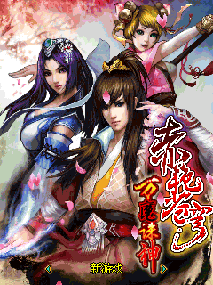 | Boots only | 200f + 6×lsk | Illustrated title art; no menu reached. |
| 13 | `三国战鼓争霸破解版.mrp` | 240×320 |  | Partial | 200f + 6×lsk | 三国战鼓争霸 title card with 开始游戏 / 点击开始. |
| 14 | `三国猛将关羽传.mrp` | 240×320 | 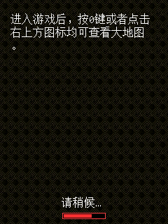 | Boots only | 200f + 6×lsk | Instruction text with a 请稍候… prompt; gameplay not reached. |
| 15 | `三角洲特种部队2.mrp` | 240×320 |  | Partial | 200f + 6×lsk | 三角洲特种部队2 title art with a 开始游戏 button. |
| 16 | `上海滩风雨迷情.mrp` | 240×320 |  | Blocked (network) | 200f + 6×lsk | 连接服务器失败 with a 返回 softkey. |
| 17 | `仙女奇缘.mrp` | 240×320 |  | Boots only | 200f + 6×lsk | Red decorative screen with a character sprite; no menu visible. |
| 18 | `倚天屠龙绝情剑.mrp` | 240×320 |  | Boots only | 200f + 6×lsk | Loading bar with 加载游戏资源 24%. |
| 19 | `倩女幽魂-媚妖情缘.mrp` | 240×320 |  | Blocked (network) | 200f + 6×lsk | 连接服务器失败 with a 返回 softkey. |
| 20 | `僵尸达人(令牌+广告条).mrp` | 240×320 | 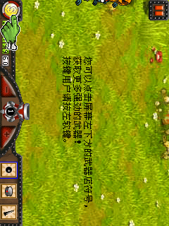 | Partial | 200f + 6×lsk | Grass battlefield with tutorial text, unit icons and HUD; gameplay screen reached. |
| 21 | `六指琴魔.mrp` | 240×320 |  | Boots only | 200f + 6×lsk | White splash with a green 巴米巴 logo. |
| 22 | `剑侠奇缘.mrp` | 240×320 | 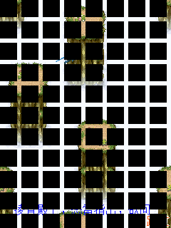 | Partial | 200f + 6×lsk | Grid puzzle board with colored tiles and a bottom control bar. |
| 23 | `剑侠无双魔女情破解版.mrp` | 240×320 | 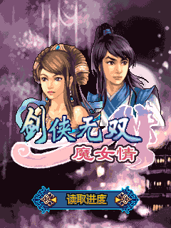 | Partial | 200f + 6×lsk | 剑侠无双 魔女情 title art with a start button. |
| 24 | `劲爆摩托-破解版无rc.mrp` | 240×320 |  | Blocked (network) | 200f + 6×lsk | 连接服务器失败 on a download-notice page. |
| 25 | `华山论剑.mrp` | 240×320 |  | Boots only | 200f + 6×lsk | Dark story page ending with 杨过林要走！. |
| 26 | `华山论剑破解版.mrp` | 240×320 |  | Boots only | 200f + 6×lsk | The same 杨过林要走！ story page in the cracked build. |
| 27 | `南京颂歌街头霸王.mrp` | 240×320 | 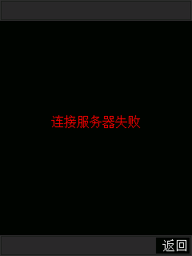 | Blocked (network) | 200f + 6×lsk | 连接服务器失败 with a 返回 softkey. |
| 28 | `反恐奇兵-沙鹰行动.mrp` | 240×320 | 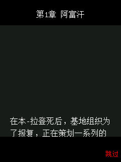 | Boots only | 200f + 6×lsk | 第1章 阿富汗 story text; gameplay not reached. |
| 29 | `变形战机.mrp` | 240×320 | 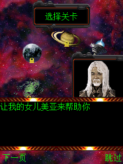 | Partial | 200f + 6×lsk | 选择关卡 screen with a stage thumbnail and character portrait. |
| 30 | `口袋灵兽.mrp` | 240×320 | 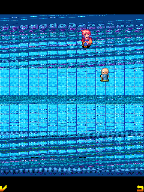 | Partial | 200f + 6×lsk | Blue tiled field with a character sprite and HUD. |
| 31 | `合金弹头-万能战车.mrp` | 240×320 | 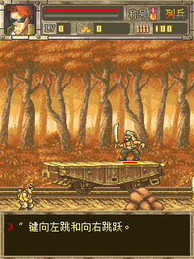 | Partial | 200f + 6×lsk | Side-scrolling stage with HUD and characters; gameplay reached, in-game controls unverified. |
| 32 | `合金弹头：东京沉没.mrp` | 240×320 | 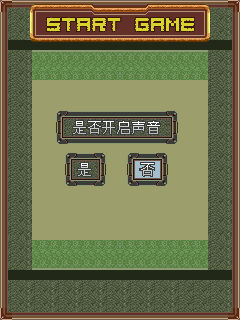 | Partial | 200f + 6×lsk | START GAME menu with a 是否开启声音 prompt. |
| 33 | `名侦探柯南-南京颂歌（破解版）.mrp` | 240×320 |  | Blocked (network) | 200f + 6×lsk | 连接服务器失败 with a 返回 softkey. |
| 34 | `周杰伦大灌篮.mrp` | 240×320 | 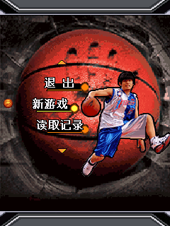 | Partial | 200f + 6×lsk | Basketball menu with 退出 / 新游戏 / 读游戏记录. |
| 35 | `圣剑封魔录.mrp` | 240×320 |  | Boots only | 200f + 6×lsk | 提示 / 检测中… 100% SDK check screen. |
| 36 | `圣魔之血.mrp` | 240×320 | 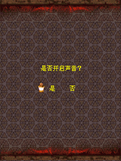 | Boots only | 200f + 6×lsk | 声音设置 screen with 是否开启声音? and 是/否. |
| 37 | `地下城魔兽mrpyx.cn_1002.mrp` | 240×320 |  | Boots only | 200f + 6×lsk | 提示 / 检测中… 100% SDK check screen. |
| 38 | `大富翁.mrp` | 240×320 | 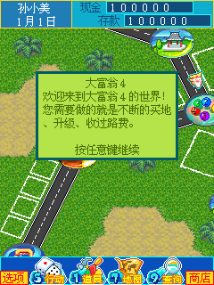 | Partial | 200f + 6×lsk | 大富翁4 board with a tutorial popup and HUD; gameplay reached. |
| 39 | `大话三国(三英现世)吞食天地系列.mrp` | 240×320 | 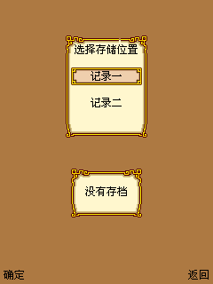 | Partial | 200f + 6×lsk | 选择存档位置 dialog with 记录一 / 记录二. |
| 40 | `大鱼吃小鱼-破解版无rc.mrp` | 240×320 |  | Boots only | 200f idle | Idle capture shown: title artwork with an audio prompt. The six-press run reaches a server-failure page. |
| 41 | `夺宝奇缘1.mrp` | 240×320 |  | Boots only | 200f + 6×lsk | Illustrated character art; no menu reached. |
| 42 | `夺宝奇缘2.mrp` | 240×320 | 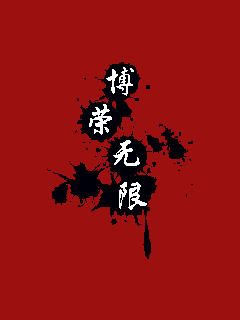 | Boots only | 200f + 6×lsk | Red splash with 传奇无限 calligraphy. |
| 43 | `宠物王国白金.mrp` | 240×320 |  | Boots only | 200f + 6×lsk | Loading progress bar. |
| 44 | `寻仙记-问道.mrp` | 240×320 |  | Boots only | 200f + 6×lsk | Story text beginning 孤山派白衣少年…. |
| 45 | `少林寺2.mrp` | 240×320 | 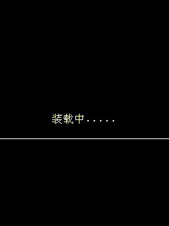 | Boots only | 200f + 6×lsk | 加载中… dark loading screen. |
| 46 | `山脊赛车-无rc破解版.mrp` | 240×320 | 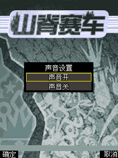 | Boots only | 200f idle | Idle capture shown: 山脊赛车 title art with an audio prompt. The six-press run reaches a server-failure page. |
| 47 | `已破-斯芬克仙游九重天_大屏动作格斗.mrp` | 240×320 |  | Boots only | 200f + 6×lsk | 提示 / 检测中… 100% SDK check screen. |
| 48 | `已破传奇地下城魔兽 240 320.mrp` | 240×320 |  | Boots only | 200f + 6×lsk | 提示 / 检测中… 100% SDK check screen. |
| 49 | `幻想水浒武松传.mrp` | 240×320 | 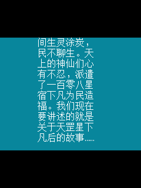 | Boots only | 200f + 6×lsk | Blue story panel with narrative text. |
| 50 | `开心农场-破解版无rc.mrp` | 240×320 |  | Partial | 200f + 6×lsk | 开心农场 title menu with 开始游戏 / 游戏帮助 / 退出游戏. |
| 51 | `异界传说之枪魂无敌.mrp` | 240×320 | 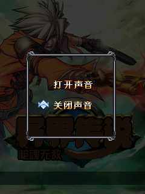 | Boots only | 200f + 6×lsk | 打开声音 / 关闭声音 dialog over illustrated background. |
| 52 | `弹弹达人堂.mrp` | 240×320 |  | Boots only | 200f + 6×lsk | White splash with a green m logo. |
| 53 | `御剑江湖仙魔劫.mrp` | 240×320 | 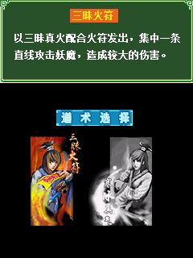 | Partial | 200f + 6×lsk | 三消教程 tutorial panel with illustrated mode choices. |
| 54 | `怪物猎人.mrp` | 240×320 |  | Blocked (network) | 200f + 6×lsk | 连接服务器失败 with a 返回 softkey. |
| 55 | `恶魔猎手1.mrp` | 240×320 |  | Boots only | 200f + 6×lsk | 提示 / 检测中… 100% SDK check screen. |
| 56 | `恶魔猎手2.mrp` | 240×320 |  | Boots only | 200f + 6×lsk | 提示 / 检测中… 100% SDK check screen. |
| 57 | `恶魔猎手3正版.mrp` | 240×320 |  | Boots only | 200f + 6×lsk | 提示 / 检测中… 100% SDK check screen. |
| 58 | `战国英雄传.mrp` | 240×320 | 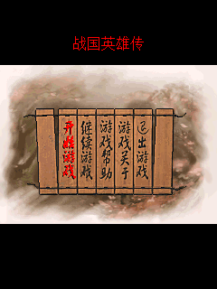 | Boots only | 200f idle | Idle capture shown: scroll-style title art. The six-press run reaches only a loading screen. |
| 59 | `指环王之霍比特人正版（240x400）.mrp` | 240×400 | 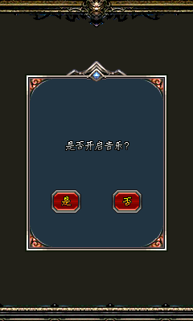 | Boots only | 200f idle | Idle capture shown: a menu panel on a 240×400 screen. The six-press run reaches a server-failure page. |
| 60 | `掌娱最终幻想.mrp` | 240×320 |  | Partial | 200f + 6×lsk | 最终幻想 title art with 开始游戏. |
| 61 | `斯芬克斯神兽传说3(破解版).mrp` | 240×320 |  | Boots only | 200f + 6×lsk | 提示 / 检测中… 100% SDK check screen. |
| 62 | `新大唐双龙传.mrp` | 240×320 |  | Boots only | 200f + 6×lsk | Story text 宁汉末年，群雄并起，英雄辈出。 |
| 63 | `新少林寺2011.mrp` | 240×320 | 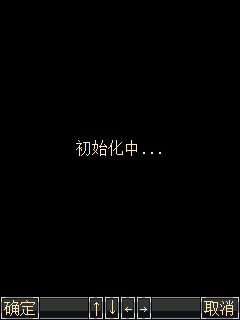 | Boots only | 200f + 6×lsk | 初始化中… progress screen with 确定 / 取消. |
| 64 | `新神兽传说使命召唤(破解版).mrp` | 240×320 | 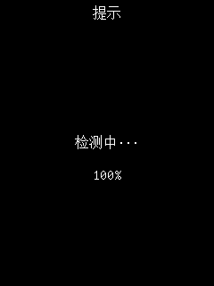 | Boots only | 200f + 6×lsk | 提示 / 检测中… 100% SDK check screen. |
| 65 | `新神兽传说使命召唤.mrp` | 240×320 |  | Boots only | 200f + 6×lsk | 提示 / 检测中… 100% SDK check screen. |
| 66 | `星际争霸.mrp` | 240×320 |  | Blocked (network) | 200f + 6×lsk | 连接服务器失败 with a 返回 softkey. |
| 67 | `最终幻想.mrp` | 240×320 | 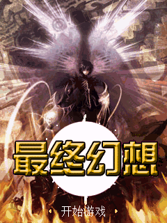 | Partial | 200f + 6×lsk | 最终幻想 title art with 开始游戏. |
| 68 | `最终幻想之水晶塔防.mrp` | 240×320 | 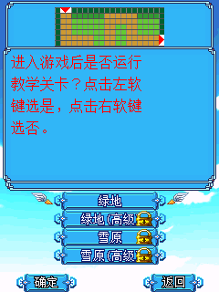 | Partial | 200f + 6×lsk | 进入游戏是否运行? tutorial prompt with 确定 / 取消 and mode buttons. |
| 69 | `机甲风暴.mrp` | 240×320 | 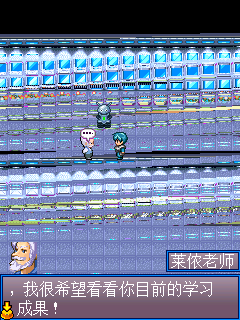 | Partial | 200f + 6×lsk | Blue battlefield with HUD and player craft; gameplay reached, in-game controls unverified. |
| 70 | `杀戮街头.mrp` | 240×320 |  | Boots only | 200f + 6×lsk | 凯科信息 / TrumpTek logo splash. |
| 71 | `枭龙战机.mrp` | 240×320 | 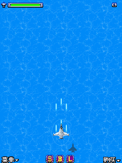 | Partial | 200f + 6×lsk | Top-down shooter stage with HUD and player ship. |
| 72 | `核心危机.mrp` | 240×320 | 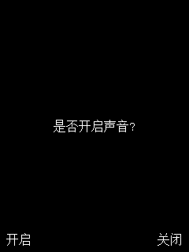 | Boots only | 200f + 6×lsk | 是否开启声音? audio prompt; scripted presses do not advance it. |
| 73 | `梦幻修仙录(梦幻诛仙2).mrp` | 240×320 | 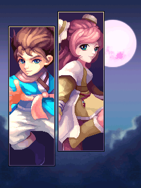 | Boots only | 200f + 6×lsk | Illustrated character cards splash. |
| 74 | `梦幻西游-无敌战神.mrp` | 240×320 |  | Blocked (network) | 200f + 6×lsk | 连接服务器失败 with a 返回 softkey. |
| 75 | `植物僵尸2-破解版无rc.mrp` | 240×320 |  | Blocked (network) | 200f + 6×lsk | 连接服务器失败 on a download-notice page. |
| 76 | `武林Q传3-洞房花烛.mrp` | 240×320 | 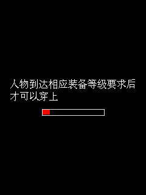 | Boots only | 200f + 6×lsk | 人物到达相应装备等级要求后才可以穿上 with a progress bar. |
| 77 | `武林群侠令狐冲.mrp` | 240×320 |  | Partial | 200f + 6×lsk | 武林群侠 令狐冲 title art with 开始游戏. |
| 78 | `水墨象棋破解版.mrp` | 240×320 |  | Boots only | 200f + 6×lsk | 水墨象棋 title art. |
| 79 | `江湖刀剑笑.mrp` | 240×320 |  | Partial | 200f + 6×lsk | 江湖刀剑笑 title art with 开始游戏. |
| 80 | `漂流幻境之美眉岛_1005.mrp` | 240×320 | 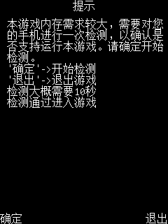 | Boots only | 200f + 6×lsk | 提示 / 本游戏内存需求较大… resource-check screen. |
| 81 | `热血三国.mrp` | 240×320 | 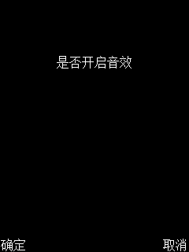 | Boots only | 200f + 6×lsk | 是否开启音效? audio prompt. |
| 82 | `画皮.mrp` | 240×320 | 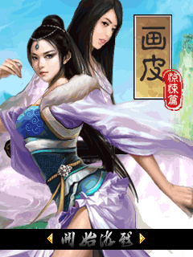 | Boots only | 200f + 6×lsk | 画皮 title art with a character illustration. |
| 83 | `真武三国志.mrp` | 240×320 | 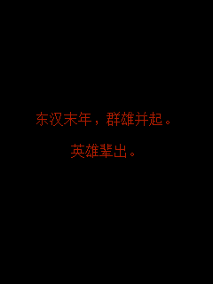 | Boots only | 200f + 6×lsk | Story text 宁汉末年，群雄并起，英雄辈出。 |
| 84 | `神雕侠侣.mrp` | 240×320 |  | Boots only | 200f + 6×lsk | 神雕侠侣 title art with two characters. |
| 85 | `精灵勇士魔王大陆.mrp` | 240×320 | 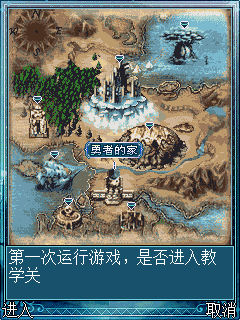 | Partial | 200f + 6×lsk | World map with a 第一次运行游戏，是否进入教程? prompt and buttons. |
| 86 | `花木兰巾帼英雄.mrp` | 240×320 |  | Boots only | 200f + 6×lsk | 是否开启声音? prompt with a warning about closing sound. |
| 87 | `血战上海滩（模拟器可玩版）.mrp` | 240×320 | 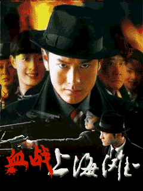 | Boots only | 200f + 6×lsk | 血战上海滩 title art. |
| 88 | `西游战神-七十二变_1002.mrp` | 240×320 |  | Boots only | 200f + 6×lsk | 提示 / 检测中… 100% SDK check screen. |
| 89 | `西门庆Q传.mrp` | 240×320 |  | Blocked (network) | 200f + 6×lsk | 连接服务器失败 with a 返回 softkey. |
| 90 | `让炮弹飞.mrp` | 240×320 |  | Blocked (network) | 200f + 6×lsk | 连接服务器失败 with a 返回 softkey. |
| 91 | `诛仙2~倾城媚狐正版（240x400）.mrp` | 240×400 | 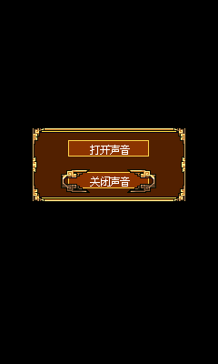 | Partial | 200f + 6×lsk | 打开声音 / 进入游戏 menu on a 240×400 screen. |
| 92 | `诛仙九神器.mrp` | 240×320 | 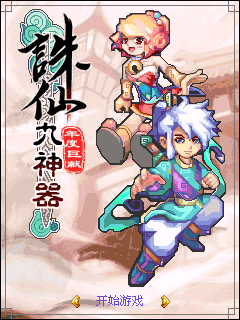 | Partial | 200f + 6×lsk | 诛仙九神器 title art with 开始游戏. |
| 93 | `轩辕之纹千年劫破解版.mrp` | 240×320 |  | Partial | 200f + 6×lsk | 轩辕之纹 千年劫 title art with 新游戏 / 读取游戏. |
| 94 | `逍遥剑侠传.mrp` | 240×320 |  | Boots only | 200f + 6×lsk | 加载游戏资源 24% loading screen. |
| 95 | `逍遥寻秦录破解版.mrp` | 240×320 | 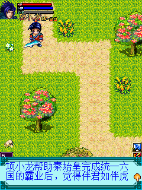 | Partial | 200f + 6×lsk | Tiled RPG field with sprites, HUD and instruction text; gameplay reached. |
| 96 | `野蛮女教师.mrp` | 240×320 | 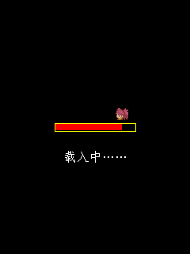 | Boots only | 200f + 6×lsk | 载入中… with a progress bar. |
| 97 | `银河争霸：钢铁武姬.mrp` | 240×320 | 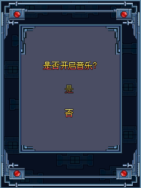 | Partial | 200f + 6×lsk | 皇叔是否重生? dialog with 是 / 否. |
| 98 | `雪饮狂刀.mrp` | 240×320 | 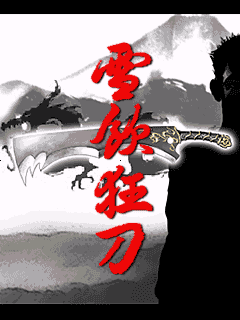 | Boots only | 200f + 6×lsk | 雪饮狂刀 title art. |
| 99 | `雷电战机.mrp` | 240×320 | 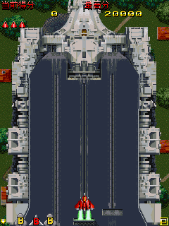 | Partial | 200f + 6×lsk | Top-down shooter stage with score and HUD; gameplay reached. |
| 100 | `飘渺傲剑录.mrp` | 240×320 |  | Boots only | 200f + 6×lsk | 飘渺傲剑录 title art with a character. |
| 101 | `魔神英雄传.mrp` | 240×320 |  | Boots only | 200f + 6×lsk | MoxiGame splash. |
| 102 | `鸳鸯蝴蝶剑.mrp` | 240×320 |  | Boots only | 200f + 6×lsk | 失败 message with task text and a loading bar. |
| 103 | `龙剑江湖任务破解.mrp` | 240×320 |  | Blocked (network) | 200f + 6×lsk | 连接服务器失败 on a download-notice page. |
| 104 | `龙珠z赛亚人来袭破解版.mrp` | 240×320 |  | Boots only | 200f + 6×lsk | Story text 遥远的宇宙中… with a comet image. |
| 105 | `龙珠之进化破解版.mrp` | 240×320 |  | Blocked (network) | 200f + 6×lsk | 连接服务器失败 with a 返回 softkey. |

## Reporting a Compatibility Issue

Include the package file name, the header version
and app ID, the screen resolution, the last visible screen, the triggering
input and the log output. Do not attach copyrighted `.mrp` packages to public
reports.
